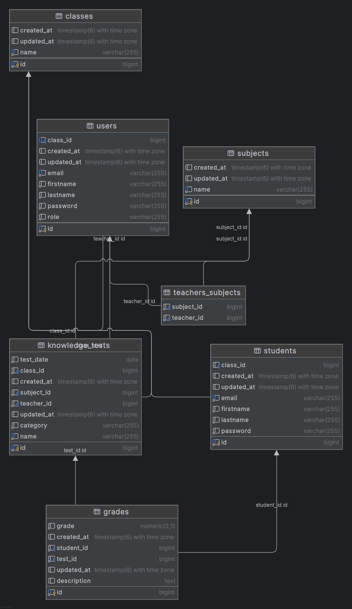
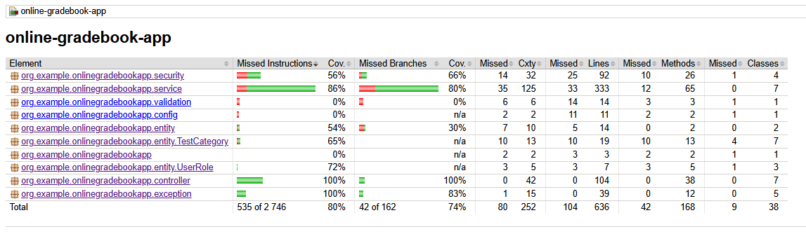
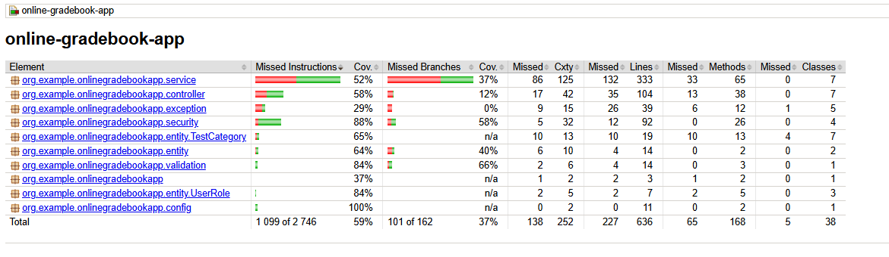

# 📘 Online gradebook app - Spring Boot REST API

The REST API application for managing students, teachers, classes, knowledge tests and grades.
Supports different roles of users (ADMIN, TEACHER) and access control based on roles and identifiers.

---

## Table of contents

1. [Technologies](#-technologies)
2. [Architecture and design patterns](#-architecture-and-design-patterns)
3. [Starting application](#-starting-application)
4. [Database structure](#-database-structure)
5. [Testing](#-testing)
6. [Security](#-security)
7. [Role Permissions](#-role-permissions)

---

## 🧰 Technologies

- Java 17+
- Spring Boot
- Spring Security (JWT)
- Spring Data JPA
- PostgresSQL 17
- Maven 3.4.4
- TestContainers, JUnit 5
- Lombok
- Flyway (database migration)

---

## ⚙️ Architecture and design patterns

- Three-layer architecture (Controller - Service - Repository)
- MVC Design Pattern
- Repository pattern
- DTO (Data Transfer Object) pattern
- Singleton (Spring beans)

---

## 🚀 Starting application

### Option 1 - locally

#### Requirements

- Java 17+
- Maven 3.4.4+
- PostgresSQL

#### Configuration:

1. Copy environment template and set your own values (DB credentials + JWT secret):

    ```shell
    cp .env.example .env
    # edit .env — replace all change-me placeholders
    ```

2. Create database and user (use the same credentials as in `.env`):

    ```sql
    CREATE DATABASE online_grade_book;
    CREATE USER admin WITH PASSWORD 'your-db-password';
    GRANT ALL PRIVILEGES ON DATABASE online_grade_book TO admin;
    ```

3. Export variables from `.env` (or set them in your IDE run configuration), then run:

    ```shell
    git clone https://github.com/geniuszmath75/online-gradebook-app.git
    cd online-gradebook-app
    set -a && source .env && set +a
    ./mvnw clean install
    ./mvnw spring-boot:run
    ```

`application.properties` reads `DB_HOST`, `DB_PORT`, `DB_NAME`, `DB_USERNAME`, `DB_PASSWORD`, and `JWT_SECRET` from the environment.

### Option 2 - Docker

#### Requirements

- Docker
- Docker Compose

1. Build and run containers

   ```shell
   # Clone repository
   git clone https://github.com/geniuszmath75/online-gradebook-app.git
   cd online-gradebook-app

   # Configure secrets (required)
   cp .env.example .env
   # edit .env — replace all change-me placeholders

   # Build and run (Compose loads .env automatically)
   docker compose up --build
   ```

**The application is available at: `http://localhost:8080/swagger-ui/index.html`**

**Flyway seeds a default ADMIN user**

**ADMIN login details:**

- email: `admin@gmail.com`
- password: `admin123`

---

## 🗃️ Database structure



---

## 🧪 Testing:

### Unit and integration tests:
   ```shell
   ./mvnw clean verify
   ```
#### 1. Unit tests coverage report `target/jacoco-ut/index.html`

   

#### 2. Integration tests coverage report `target/jacoco-it/index.html`



---

## 🔐 Security

- JWT Authentication ([implementation](src/main/java/org/example/onlinegradebookapp/security/JwtService.java))
- Roles: 
  - `ADMIN` - system administrator, responsible for managing all resources.
  - `TEACHER` - teacher, allowed to create knowledge tests, assign grades, and manage class-related data.
  - `STUDENT` - assigned to student accounts **only for authorization purposes in Spring Security**.
   
> [!NOTE]
> The `STUDENT` role is not defined in any enum or persisted in the database.
> It exists solely to fulfill the requirement of assigning a role in the Spring Security configuration.
> Student-specific operations are handled through the `Student` entity and its associations, not through role checks.

- Endpoints secured with `@PreAuthorize` and `SecurityContext`

---

## 🔓 Role Permissions
The following table summarizes which roles are allowed to access specific API endpoints.

- ✅ Full access
- ☑️ Limited access (e.g., only own ID, only own class)
- ❌ No access

> [!NOTE]
> Some endpoints (e.g., retrieving or updating a user by ID) are role-restricted **by ownership**
> i.e., teachers and students can only access their own data.

| Endpoint                           | ADMIN | TEACHER     | STUDENT     |
|------------------------------------|-------|-------------|-------------|
| `GET /api/users`                   | ✅     | ❌           | ❌           |
| `GET /api/users/{id}`              | ✅     | ☑️ (own ID) | ❌           |
| `PATCH /api/users/{id}`            | ✅     | ☑️ (own ID) | ❌           |
| `DELETE /api/users/{id}`           | ✅     | ❌           | ❌           |
| `GET /api/students`                | ✅     | ✅           | ❌           |
| `GET /api/students/{id}`           | ✅     | ✅           | ☑️ (own ID) |
| `PATCH /api/students/{id}`         | ✅     | ✅           | ☑️ (own ID) |
| `DELETE /api/students/{id}`        | ✅     | ❌           | ❌           |
| `POST /api/subjects`               | ✅     | ❌           | ❌           |
| `GET /api/subjects`                | ✅     | ✅           | ❌           |
| `GET /api/subjects/{id}`           | ✅     | ✅           | ❌           |
| `PUT /api/subjects/{id}`           | ✅     | ❌           | ❌           |
| `DELETE /api/subjects/{id}`        | ✅     | ❌           | ❌           |
| `POST /api/classes`                | ✅     | ❌           | ❌           |
| `GET /api/classes`                 | ✅     | ✅           | ❌           |
| `GET /api/classes/{id}`            | ✅     | ✅           | ❌           |
| `PUT /api/classes/{id}`            | ✅     | ❌           | ❌           |
| `DELETE /api/classes/{id}`         | ✅     | ❌           | ❌           |
| `POST /api/knowledge_tests`        | ✅     | ✅           | ❌           |
| `GET /api/knowledge_tests`         | ✅     | ✅           | ❌           |
| `GET /api/knowledge_tests/{id}`    | ✅     | ✅           | ❌           |
| `PATCH /api/knowledge_tests/{id}`  | ✅     | ☑️ (author) | ❌           |
| `DELETE /api/knowledge_tests/{id}` | ✅     | ☑️ (author) | ❌           |
| `POST /api/grades`                 | ✅     | ✅           | ❌           |
| `GET /api/grades`                  | ✅     | ✅           | ❌           |
| `GET /api/grades/{id}`             | ✅     | ✅           | ❌           |
| `PATCH /api/grades/{id}`           | ✅     | ☑️ (author) | ❌           |
| `DELETE /api/grades/{id}`          | ✅     | ☑️ (author) | ❌           |
