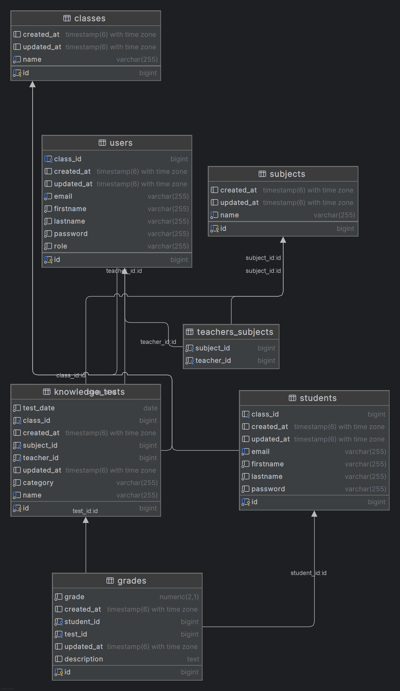

# 📘 Online Gradebook

Online Gradebook is a full-stack school gradebook application. The backend exposes a
Spring Boot REST API for managing users, students, classes, subjects, knowledge tests
and grades. The Vue frontend consumes that API and provides role-aware screens for
administrators, teachers and students.

---

## Table of contents

1. [Technologies](#-technologies)
2. [Architecture](#-architecture)
3. [Running the application](#-running-the-application)
4. [Available functionality](#-available-functionality)
5. [Database structure](#-database-structure)
6. [API documentation](#-api-documentation)
7. [Testing](#-testing)
8. [Security and roles](#-security-and-roles)

---

## 🧰 Technologies

### Backend

- Java 17
- Spring Boot
- Spring Security with JWT
- Spring Data JPA and Hibernate
- PostgreSQL 17
- Flyway database migrations
- Maven Wrapper
- JUnit 5, Mockito and Testcontainers
- Lombok

### Frontend

- Vue 3
- Vite
- TypeScript
- Vue Router
- Pinia
- Axios

---

## ⚙️ Architecture

- Three-layer backend architecture: Controller → Service → Repository
- REST API with request and response DTOs
- PostgreSQL persistence managed by Spring Data JPA
- Database schema managed by Flyway; Hibernate runs in validation mode
- JWT authentication and role-based authorization
- Vue SPA in `frontend/`, developed independently from the backend
- Docker Compose runs the backend and PostgreSQL; the frontend runs locally with Vite

---

## 🚀 Running the application

### Prerequisites

- Docker and Docker Compose
- Node.js `^20.19.0` or `>=22.12.0` for the frontend
- Java 17 only when running the backend outside Docker

### 1. Configure environment variables

The root `.env` file is used by Docker Compose and the backend. Create it from the
template and replace every placeholder:

```shell
cp .env.example .env
```

Important variables:

- `DB_NAME`, `DB_USERNAME`, `DB_PASSWORD` — PostgreSQL database credentials
- `JWT_SECRET` — Base64-encoded JWT signing secret
- `CORS_ALLOWED_ORIGINS` — browser origins allowed by the backend

The frontend has its own optional configuration:

```shell
cd frontend
cp .env.example .env
```

Leave `VITE_API_BASE_URL` empty for local development. Vite then proxies `/api`
requests to `http://localhost:8080`.

### 2. Start the backend and database with Docker Compose

Run these commands from the repository root:

```shell
docker compose up --build
```

Compose starts:

- PostgreSQL on `localhost:${DB_PORT}` (usually `localhost:5432`)
- the Spring Boot API on `http://localhost:8080`

Flyway creates/validates the schema on startup. Stop the services with
`Ctrl+C`, or use `docker compose down`. To remove the persisted database volume
as well, run `docker compose down -v`.

On a fresh database, the Flyway seed creates demo accounts for local evaluation:

- Admin: `admin@gmail.com` / `admin123`
- Teachers: `teacher.kowalski@example.com`, `teacher.nowak@example.com` or
  `teacher.wisniewski@example.com` / `teacher123`
- Students: `student.adamczyk@example.com` and other seeded students /
  `student123`

### 3. Start the Vue frontend locally

In a second terminal:

```shell
cd frontend
npm install
npm run dev
```

Open `http://localhost:5173`. The frontend uses the Vite proxy, so no separate
frontend container is required.

### Running the backend locally

Alternatively, run PostgreSQL separately, export the variables from `.env`, and
start Spring Boot with the Maven Wrapper:

```shell
set -a && source .env && set +a
./mvnw spring-boot:run
```

## ✨ Available functionality

### Vue frontend

- JWT login and logout
- Role-aware navigation for `ADMIN`, `TEACHER` and `STUDENT`
- Student list with pagination, sorting, email/class filters and CRUD operations
- Grade CRUD with pagination, sorting, student/test/date filters and validation
- Class list and admin CRUD operations
- Knowledge test management
- Admin-only user and subject management
- Student profile view
- API error messages displayed in the UI

### REST API

The API supports CRUD operations for users, students, classes, subjects, knowledge
tests and grades. It also provides pagination/filtering for students and grades,
request validation, global error responses and role/ownership checks.

---

## 🗃️ Database structure



---

## 📚 API documentation

After starting the backend, open:

- Swagger UI: [`http://localhost:8080/swagger-ui/index.html`](http://localhost:8080/swagger-ui/index.html)
- OpenAPI JSON: [`http://localhost:8080/v3/api-docs`](http://localhost:8080/v3/api-docs)

The API base path is `http://localhost:8080/api`. Login is available at
`POST /api/auth/login`; the returned JWT is used as a Bearer token for protected
endpoints. The Swagger UI can be used to inspect and try the REST contract.

## 🧪 Testing

Run the complete backend test suite:

```shell
./mvnw clean verify
```

This runs unit and integration tests, including Testcontainers-based PostgreSQL
tests. Coverage reports are generated at:

- `target/jacoco-ut/index.html`
- `target/jacoco-it/index.html`

Frontend checks/build:

```shell
cd frontend
npm run build
```

---

## 🔐 Security and roles

- JWT Authentication ([implementation](src/main/java/org/example/onlinegradebookapp/security/JwtService.java))
- Roles: 
  - `ADMIN` - system administrator, responsible for managing all resources.
  - `TEACHER` - teacher, allowed to create knowledge tests, assign grades, and manage class-related data.
  - `STUDENT` - assigned to student accounts **only for authorization purposes in Spring Security**.
   
> [!NOTE]
> The `STUDENT` role is not defined in any enum or persisted in the database.
> It exists solely to fulfill the requirement of assigning a role in the Spring Security configuration.
> Student-specific operations are handled through the `Student` entity and its associations, not through role checks.

- Endpoints secured with `@PreAuthorize` and `SecurityContext`

---

## 🔓 Role Permissions
The following table summarizes which roles are allowed to access specific API endpoints.

- ✅ Full access
- ☑️ Limited access (e.g., only own ID, own test or own grade)
- ❌ No access

> [!NOTE]
> Some endpoints (e.g., retrieving or updating a user by ID) are role-restricted **by ownership**
> i.e., teachers and students can only access their own data.
> The knowledge-test list and grade endpoints additionally limit teachers to tests they authored;
> `GET /api/knowledge_tests/{id}` is currently unrestricted by author.

| Endpoint                           | ADMIN | TEACHER     | STUDENT     |
|------------------------------------|-------|-------------|-------------|
| `GET /api/users`                   | ✅     | ❌           | ❌           |
| `GET /api/users/{id}`              | ✅     | ☑️ (own ID) | ❌           |
| `PATCH /api/users/{id}`            | ✅     | ☑️ (own ID) | ❌           |
| `DELETE /api/users/{id}`           | ✅     | ❌           | ❌           |
| `GET /api/students`                | ✅     | ✅           | ❌           |
| `GET /api/students/{id}`           | ✅     | ✅           | ☑️ (own ID) |
| `PATCH /api/students/{id}`         | ✅     | ✅           | ☑️ (own ID) |
| `DELETE /api/students/{id}`        | ✅     | ❌           | ❌           |
| `POST /api/subjects`               | ✅     | ❌           | ❌           |
| `GET /api/subjects`                | ✅     | ✅           | ❌           |
| `GET /api/subjects/{id}`           | ✅     | ✅           | ❌           |
| `PUT /api/subjects/{id}`           | ✅     | ❌           | ❌           |
| `DELETE /api/subjects/{id}`        | ✅     | ❌           | ❌           |
| `POST /api/classes`                | ✅     | ❌           | ❌           |
| `GET /api/classes`                 | ✅     | ✅           | ❌           |
| `GET /api/classes/{id}`            | ✅     | ✅           | ❌           |
| `PUT /api/classes/{id}`            | ✅     | ❌           | ❌           |
| `DELETE /api/classes/{id}`         | ✅     | ❌           | ❌           |
| `POST /api/knowledge_tests`        | ✅     | ✅           | ❌           |
| `GET /api/knowledge_tests`         | ✅     | ☑️ (own tests) | ❌           |
| `GET /api/knowledge_tests/{id}`    | ✅     | ✅           | ❌           |
| `PATCH /api/knowledge_tests/{id}`  | ✅     | ☑️ (author) | ❌           |
| `DELETE /api/knowledge_tests/{id}` | ✅     | ☑️ (author) | ❌           |
| `POST /api/grades`                 | ✅     | ☑️ (own tests) | ❌           |
| `GET /api/grades`                  | ✅     | ☑️ (own tests) | ❌           |
| `GET /api/grades/{id}`             | ✅     | ☑️ (author) | ❌           |
| `PATCH /api/grades/{id}`           | ✅     | ☑️ (author) | ❌           |
| `DELETE /api/grades/{id}`          | ✅     | ☑️ (author) | ❌           |
